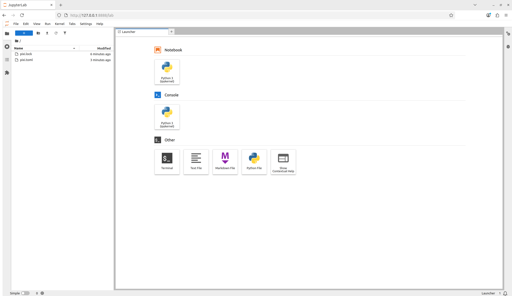

::: questions

* What is Pixi?
* How does Pixi enable fully reproducible software environments?
* What are Pixi's semantics?

:::

::: objectives

* Outline Pixi's workflow design
* Summarize the relationship between a Pixi manifest and a lock file
* Create a multi-platform and multi-environment Pixi workspace

:::

## Pixi

As described in the previous section on computational reproducibility, to have reproducible software environments we need tools that can take high level human writeable environment configuration files and produce machine-readable, digest-level lock files that exactly specify every piece of software that exists in an environment.

[Pixi](https://www.pixi.sh/) is a cross-platform package and environment manager that can handle complex development workflows.
Importantly, Pixi automatically and non-optionally will produce or update a lock file for the software environments defined by the user whenever any actions mutate the environment.
Pixi is written in Rust, and leverages the language's speed and technologies to solve environments fast.

Pixi addresses the concept of computational reproducibility by focusing on a set of main features:

1. **Virtual environment management**: Pixi can create environments that contain conda packages and Python packages and use or switch between environments easily.
1. **Package management**: Pixi enables the user to install, update, and remove packages from these environments through the `pixi` command line interface.
1. **Task management**: Pixi has a task runner system built-in, which allows for tasks with custom logic and dependencies on other tasks to be created.

It also combines these features with robust behaviors:

1. **Automatic lock files**: Any changes to a Pixi workspace that can mutate the environments defined in it will automatically and non-optionally result in the Pixi lock file for the workspace being updated.
This ensures that any and every state of a Pixi project is trivially computationally reproducible.
1. **Solving environments for other platforms**: Pixi allows the user to solve environments for platforms other than the current user's machine.
This allows for users to solve and share environments with any collaborator with confidence that all environments will work with no additional setup.
1. **Parity of conda and Python packages**: Pixi allows for conda packages and Python packages to be used together seamlessly, and is unique in its ability to handle overlap in dependencies between them.
Pixi will first solve all conda package requirements for the target environment, lock the environment, and then solve all the dependencies of the Python packages for the environment, determine if there are any overlaps with the existing conda environment, and then only install the missing Python dependencies.
This allows for fully reproducible solves and for the two package ecosystems to complement each other rather than potentially cause conflicts.
1. **Efficient caching**: Pixi uses an extremely efficient global caching scheme.
This means that the first time a package is installed on a machine with Pixi is the slowest it will ever be to install it for any future project on the machine while the cache is still active.

## Project-based workflows

Pixi uses a "project-based" workflow which scopes a workspace and the installed tooling for a project to the project's directory tree.

**Pros**

* Environments in the workspace are isolated to the project and can not cause conflicts with any tools or projects outside of the project.
* A high level declarative syntax allows for users to state only what they need, making even complex environments easy to understand and share.
* Environments can be treated as transient and be fully deleted and then rebuilt within seconds without worry about breaking other projects.
This allows for much greater freedom of exploration and development without fear.

**Cons**

* As each project has its own environments, the same package can exist in many environments on one machine, and the total amount of disk space used can be larger than with other forms of development workflows.

::: callout

## Disk space and the package cache

When the global package cache and the project environment are on the same file system, Pixi [links most of the package files from the cache into each environment](https://prefix.dev/blog/what-linking-means-when-installing-a-conda-package) instead of copying them, taking much less extra disk space than it might appear.
However, when the cache and the project environment are on different file systems (e.g. a home directory and a scratch space on an HPC system) the files are copied, and the total amount of disk space used can be much larger.

This can be avoided by setting the [`PIXI_CACHE_DIR`](https://pixi.prefix.dev/latest/workspace/environment/#caching-packages) environment variable to a directory on the same file system as your projects, and mitigated on disk limited machines by removing the environments of projects not in use with [`pixi clean`](https://pixi.prefix.dev/latest/reference/cli/pixi/clean/#pixi-clean) (while keeping their lock files) and periodically cleaning the cache with `pixi clean cache`.

:::

* Each project is set up separately, with its own manifest, lock file, and environments that need to be solved and installed, and nothing is shared implicitly between projects.

::: callout

## Sharing between projects

Tools that you want available everywhere need to be added to each project or installed globally (see "Global Tools" below), though packages already in the cache are reused rather than downloaded again.

If you would like to use a workspace's environments from any directory, more like a traditional named conda environment, Pixi also supports [named workspaces](https://pixi.sh/latest/switching_from/conda/#named-workspaces) that are registered with [`pixi workspace register`](https://pixi.prefix.dev/latest/reference/cli/pixi/workspace/register/) and can then be used by name with the `--workspace` option (e.g. `pixi shell --workspace <name>`).

:::

## Pixi project files and the CLI basics

Every Pixi project begins with creating a manifest file.
A manifest file is a declarative configuration file that lists what the high level requirements of a project are.
Pixi then takes those requirements and constraints and solves for the full dependency tree.

Let's create our first Pixi project.
First, to have a uniform directory tree experience, clone the `pixi-cuda-lesson` GitHub repository (which you made as part of the setup) under your home directory on your machine and navigate to it.

```bash
cd ~
git clone git@github.com:<username>/pixi-cuda-lesson.git
cd ~/pixi-cuda-lesson
```

Then use `pixi init` to create a new project directory and initialize a Pixi manifest with your machine's configuration.

```bash
pixi init example
```

```output
Created /home/<username>/pixi-cuda-lesson/example/pixi.toml
```

Navigate to the `example` directory and check the directory structure

:::: group-tab

### Unix and Windows Terminal

```bash
cd example
ls -1ap
```

```output
./
../
.gitattributes
.gitignore
pixi.toml
```

### Windows PowerShell

```powershell
cd example
ls | fw -col 1
```

```output
.gitattributes
.gitignore
pixi.toml
```

::::

We see that Pixi has set up Git configuration files for the project as well as a Pixi manifest `pixi.toml` file.
Checking the default manifest file, we see three TOML tables: `workspace`, `tasks`, and `dependencies`.

```bash
cat pixi.toml
```

```toml
[workspace]
authors = ["Your Name <your email from your global Git config>"]
channels = ["conda-forge"]
name = "example"
# This will be whatever your machine's platform is
platforms = ["linux-64"]
version = "0.1.0"

[tasks]

[dependencies]
```

* [`workspace`][workspace table]: Defines metadata and properties for the entire project.
* [`tasks`][task table]: Defines tasks for the task runner system to execute from the command line and their dependencies.
* [`dependencies`][dependencies table]: Defines the conda package dependencies from the `channels` in your `workspace` table.

::: callout

For the rest of the lesson we'll ignore the `authors` list in our discussions as it is optional and will be specific to you.

:::

At the moment there are no dependencies defined in the manifest, so let's add Python using the [`pixi add` command](https://pixi.sh/latest/reference/cli/pixi/add/).

```bash
pixi add python
```

```output
✔ Added python >=3.15.2,<3.16
```

What happened?
We saw that `python` got added, and we can see that the `pixi.toml` manifest now contains `python` as a dependency

```bash
cat pixi.toml
```

```toml
[workspace]
channels = ["conda-forge"]
name = "example"
# This will be whatever your machine's platform is
platforms = ["linux-64"]
version = "0.1.0"

[tasks]

[dependencies]
python = ">=3.15.2,<3.16"
```

Further, we also now see that a `pixi.lock` lock file has been created in the project directory as well as a `.pixi/` directory.

:::: group-tab

### Unix and Windows Terminal

```bash
ls -1ap
```

```output
./
../
.gitattributes
.gitignore
.pixi/
pixi.lock
pixi.toml
```

### Windows PowerShell

```powershell
ls | fw -col 1
```

```output
.pixi
.gitattributes
.gitignore
pixi.lock
pixi.toml
```
::::

The `.pixi/` directory contains the installed environments.
We can see that at the moment there is just one environment named `default`

:::: group-tab

### Unix and Windows Terminal

```bash
ls -1p .pixi/envs/
```
```output
default/
```

### Windows PowerShell

```powershell
ls .pixi\envs | fw -col 1
```
```output
default
```
::::

Inside the `.pixi/envs/default/` directory are all the libraries, header files, and executables that are needed by the environment.

The `pixi.lock` lock file is a YAML file that contains three definition groups: `platforms`, `environments`, and `packages`.
The `platforms` group lists every platform the workspace is solved for, along with the virtual packages (e.g. the minimum `glibc` version) that the solve assumes the platform provides.
The `environments` group lists every environment in the workspace for every platform with a complete listing of all packages in the environment.
The `packages` group lists a full definition of every package that appears in the `environments` lists, including the package's URL on the conda package index and digests (e.g. sha256, md5).

Here's an example of what the `platforms`, `environments`, and `packages` groups look like in the `pixi.lock` file we created for a `linux-64` platform machine.

```
version: 7
platforms:
- name: linux-64
  virtual-packages:
  - __unix=0=0
  - __linux=4.18
  - __glibc=2.28
  - __archspec=0=x86_64
environments:
  default:
    channels:
    - url: https://conda.anaconda.org/conda-forge/
    packages:
      linux-64:

...

      - conda: https://conda.anaconda.org/conda-forge/linux-64/python-3.15.2-h6e52b48_100_cp315.conda
      - conda: https://conda.anaconda.org/conda-forge/linux-64/tk-8.6.13-noxft_h1df4ec4_4.conda
      - conda: https://conda.anaconda.org/conda-forge/linux-64/zstd-1.5.7-hb78ec9c_7.conda
      - conda: https://conda.anaconda.org/conda-forge/noarch/ca-certificates-2026.10.23-hbd8a1cb_0.conda
      - conda: https://conda.anaconda.org/conda-forge/noarch/python_abi-3.15-9_cp315.conda
      - conda: https://conda.anaconda.org/conda-forge/noarch/tzdata-2026e-h5d301ff_0.conda
...

packages:

...

- conda: https://conda.anaconda.org/conda-forge/linux-64/python-3.15.2-h6e52b48_100_cp315.conda
  build_number: 100
  sha256: dd6fdef748df5636029673a834ca3632ce44c86d71e4986d70bcdb2ae5607a25
  md5: 38c3edc23439db3ca383be02ae2b702e
  depends:
  - __glibc >=2.17,<3.0.a0
  - bzip2 >=1.0.8,<2.0a0
  - ld_impl_linux-64 >=2.36.1
  - libedit >=3.1.20260512,<3.2.0a0
  - libexpat >=2.8.5,<3.0a0
  - libffi >=3.7.0,<3.8.0a0
  - libgcc >=15
  - liblzma >=5.8.3,<6.0a0
  - libmpdec >=4.0.0,<5.0a0
  - libsqlite >=3.54.1,<4.0a0
  - libuuid >=2.42.4,<3.0a0
  - libzlib >=1.3.2,<2.0a0
  - ncurses >=6.6,<7.0a0
  - openssl >=3.5.9,<4.0a0
  - python_abi 3.15.* *_cp315
  - tk >=8.6.13,<8.7.0a0
  - tzdata
  - zstd >=1.5.7,<1.6.0a0
  license: Python-2.0
  run_exports:
    weak:
    - python_abi 3.15.* *_cp315
    noarch:
    - python
  size: 29327137
  timestamp: 1793015518763
  python_site_packages_path: lib/python3.15/site-packages

...
```

These groups provide a full description of every package described in the Pixi workspace and its dependencies and constraints on other packages.
This means that for each package specified, that version, and **only** that version, will be downloaded and installed in the future.

::: callout

## Lock files and security

Locking every package in an environment to an exact version and digest has consequences for the security of the environment.

**Pros**

* Packages are installed at the exact versions and digests recorded in the lock file, so new releases do not enter the environment until the lock file is explicitly updated.
This protects a locked environment from installing malicious releases of a package published after it was locked.
For example, a lock file that contained `pytorch-lightning` before the malicious `pytorch-lightning` 2.6.2 and 2.6.3 releases on PyPI that contained credential harvesting code ([CVE-2026-44484](https://github.com/advisories/GHSA-w37p-236h-pfx3)) was safe from the attack.

**Cons**

* A locked environment also does not receive security fixes until you update the lock file.
For example, after the [2026 eMudhra certificate authority incident](https://discuss.python.org/t/information-for-python-users-regarding-emudhra-emsign-ca-certificate-security-incident/109576), users needed new versions of `certifi`, `ca-certificates`, and potentially `pip`, to stop trusting the compromised certificates, and a locked environment keeps the old versions until its lock file is updated.

:::

We can even test that now by deleting the installed environment fully with [`pixi clean`](https://pixi.sh/latest/reference/cli/pixi/clean/) and then getting it back (bit for bit) in a few seconds with [`pixi install`](https://pixi.sh/latest/reference/cli/pixi/install/).

```bash
pixi clean
```
```output
  removed /home/<username>/pixi-cuda-lesson/example/.pixi/envs
```
```bash
 pixi install
```
```output
✔ The default environment has been installed.
```

We can also see all the packages that were installed and are now available for us to use with [`pixi list`](https://pixi.sh/latest/reference/cli/pixi/list/)

::: tab

### Linux

```bash
pixi list
```
```output
Installed for: linux-64
Name              Version       Build                       Size  Kind   Source
_openmp_mutex     4.5           20_gnu                 28.27 KiB  conda  https://conda.anaconda.org/conda-forge
bzip2             1.0.8         hda65f42_10           251.77 KiB  conda  https://conda.anaconda.org/conda-forge
ca-certificates   2026.10.23    hbd8a1cb_0            127.01 KiB  conda  https://conda.anaconda.org/conda-forge
ld_impl_linux-64  2.46.1        default_hbd61a6d_103  724.72 KiB  conda  https://conda.anaconda.org/conda-forge
libedit           3.1.20260512  pl5321h373387f_0      132.69 KiB  conda  https://conda.anaconda.org/conda-forge
libexpat          2.9.0         hd2095e1_0             77.04 KiB  conda  https://conda.anaconda.org/conda-forge
libffi            3.7.0         h81df57d_1             66.41 KiB  conda  https://conda.anaconda.org/conda-forge
libgcc            16.2.0        ha9f2e26_7              1.01 MiB  conda  https://conda.anaconda.org/conda-forge
libgomp           16.2.0        he0feb66_7            625.55 KiB  conda  https://conda.anaconda.org/conda-forge
liblzma           5.8.3         hb03c661_1            110.35 KiB  conda  https://conda.anaconda.org/conda-forge
libmpdec          4.0.0         hb03c661_2             90.58 KiB  conda  https://conda.anaconda.org/conda-forge
libsqlite         3.54.1        h0737f62_101          957.51 KiB  conda  https://conda.anaconda.org/conda-forge
libuuid           2.42.4        hcfc3c73_0             33.63 KiB  conda  https://conda.anaconda.org/conda-forge
libzlib           1.3.2         h25fd6f3_3             62.22 KiB  conda  https://conda.anaconda.org/conda-forge
ncurses           6.6           hdb14827_1            889.84 KiB  conda  https://conda.anaconda.org/conda-forge
openssl           3.6.5         h781a0a9_0              3.05 MiB  conda  https://conda.anaconda.org/conda-forge
python            3.15.2        h6e52b48_100_cp315     27.97 MiB  conda  https://conda.anaconda.org/conda-forge
python_abi        3.15          9_cp315                 6.64 KiB  conda  https://conda.anaconda.org/conda-forge
tk                8.6.13        noxft_h1df4ec4_4        3.40 MiB  conda  https://conda.anaconda.org/conda-forge
tzdata            2026e         h5d301ff_0            116.41 KiB  conda  https://conda.anaconda.org/conda-forge
zstd              1.5.7         hb78ec9c_7            587.21 KiB  conda  https://conda.anaconda.org/conda-forge
```

### macOS

```bash
pixi list
```
```output
Installed for: osx-arm64
Name             Version       Build                     Size  Kind   Source
bzip2            1.0.8         h4e30115_10         122.04 KiB  conda  https://conda.anaconda.org/conda-forge
ca-certificates  2026.10.23    hbd8a1cb_0          127.01 KiB  conda  https://conda.anaconda.org/conda-forge
libedit          3.1.20260512  pl5321h26f1114_0    105.97 KiB  conda  https://conda.anaconda.org/conda-forge
libexpat         2.9.0         h6111c0a_0           68.05 KiB  conda  https://conda.anaconda.org/conda-forge
libffi           3.7.0         h47dc5ef_1           42.61 KiB  conda  https://conda.anaconda.org/conda-forge
liblzma          5.8.3         h8088a28_1           89.57 KiB  conda  https://conda.anaconda.org/conda-forge
libmpdec         4.0.0         h84a0fba_2           71.57 KiB  conda  https://conda.anaconda.org/conda-forge
libsqlite        3.54.1        h34a968b_101        927.20 KiB  conda  https://conda.anaconda.org/conda-forge
libzlib          1.3.2         h8088a28_3           46.70 KiB  conda  https://conda.anaconda.org/conda-forge
ncurses          6.6           he64c551_1          785.45 KiB  conda  https://conda.anaconda.org/conda-forge
openssl          3.6.5         h55eecbc_0            2.97 MiB  conda  https://conda.anaconda.org/conda-forge
python           3.15.2        h2e4dbab_100_cp315   12.80 MiB  conda  https://conda.anaconda.org/conda-forge
python_abi       3.15          9_cp315               6.64 KiB  conda  https://conda.anaconda.org/conda-forge
tk               8.6.13        hbeba79b_4            3.19 MiB  conda  https://conda.anaconda.org/conda-forge
tzdata           2026e         h5d301ff_0          116.41 KiB  conda  https://conda.anaconda.org/conda-forge
zstd             1.5.7         hf451053_7          423.52 KiB  conda  https://conda.anaconda.org/conda-forge
```

### Windows

```bash
pixi list
```
```output
Installed for: win-64
Name             Version       Build                     Size  Kind   Source
bzip2            1.0.8         h0ad9c76_10          54.61 KiB  conda  https://conda.anaconda.org/conda-forge
ca-certificates  2026.10.23    h4c7d964_0          127.37 KiB  conda  https://conda.anaconda.org/conda-forge
libexpat         2.9.0         hac47afa_0           71.27 KiB  conda  https://conda.anaconda.org/conda-forge
libffi           3.7.0         h3d046cb_1           48.82 KiB  conda  https://conda.anaconda.org/conda-forge
liblzma          5.8.3         hfd05255_1          103.33 KiB  conda  https://conda.anaconda.org/conda-forge
libmpdec         4.0.0         hfd05255_2           87.02 KiB  conda  https://conda.anaconda.org/conda-forge
libsqlite        3.54.1        hf5d6505_101          1.27 MiB  conda  https://conda.anaconda.org/conda-forge
libzlib          1.3.2         hfd05255_3           57.16 KiB  conda  https://conda.anaconda.org/conda-forge
openssl          3.6.5         hf411b9b_0            8.97 MiB  conda  https://conda.anaconda.org/conda-forge
python           3.15.2        h53f6dd8_100_cp315   17.72 MiB  conda  https://conda.anaconda.org/conda-forge
python_abi       3.15          9_cp315               6.64 KiB  conda  https://conda.anaconda.org/conda-forge
tk               8.6.13        h967ab96_4            3.61 MiB  conda  https://conda.anaconda.org/conda-forge
tzdata           2026e         h5d301ff_0          116.41 KiB  conda  https://conda.anaconda.org/conda-forge
ucrt             10.0.26100.0  h57928b3_0          678.41 KiB  conda  https://conda.anaconda.org/conda-forge
vc               14.5          ha367084_41          20.88 KiB  conda  https://conda.anaconda.org/conda-forge
vc14_runtime     14.51.36247   habf1de7_41         749.96 KiB  conda  https://conda.anaconda.org/conda-forge
vcomp14          14.51.36247   habf1de7_41         152.26 KiB  conda  https://conda.anaconda.org/conda-forge
zstd             1.5.7         h534d264_7          378.45 KiB  conda  https://conda.anaconda.org/conda-forge
```
:::

::: challenge

## Extending the manifest

Let's extend this manifest to add the Python library `numpy` and the Jupyter tools `notebook` and `jupyterlab` as dependencies and add a [task](https://pixi.sh/latest/workspace/advanced_tasks/) called `lab` that will launch Jupyter Lab in the current working directory.

Hint: Look at the Pixi manifest table structure to think how a `task` might be added.
It is fine to read the docs too!

::: solution

Let's start at the command line and add the additional dependencies with `pixi add`

```bash
pixi add numpy notebook jupyterlab
```

We can manually edit the `pixi.toml` with a text editor to add a task named `lab` that when called executes `jupyter lab`.
This is sometimes the easiest thing to do, but we can also use the `pixi` CLI.

```bash
pixi task add lab "jupyter lab" --description "Launch JupyterLab"
```
```output
✔ Added task `lab`: jupyter lab, description = "Launch JupyterLab"
```

The resulting `pixi.toml` manifest is

:::: group-tab

### Manually edited

```toml
[workspace]
channels = ["conda-forge"]
name = "example"
platforms = ["linux-64"]
version = "0.1.0"

[tasks.lab]
description = "Launch JupyterLab"
cmd = "jupyter lab"

[dependencies]
python = ">=3.15.2,<3.16"
numpy = ">=2.5.4,<3"
notebook = ">=7.6.3,<8"
jupyterlab = ">=4.6.4,<5"
```

### `pixi task` CLI

```toml
[workspace]
channels = ["conda-forge"]
name = "example"
platforms = ["linux-64"]
version = "0.1.0"

[tasks]
lab = { cmd = "jupyter lab", description = "Launch JupyterLab" }

[dependencies]
python = ">=3.15.2,<3.16"
numpy = ">=2.5.4,<3"
notebook = ">=7.6.3,<8"
jupyterlab = ">=4.6.4,<5"
```

::::
:::
:::

With our new dependencies added to the project manifest and our `lab` task defined, let's use all of them together by launching our task using [`pixi run`](https://pixi.sh/latest/reference/cli/pixi/run/)

```bash
pixi run lab
```

and we see that Jupyter Lab launches!

{
alt='The view of the Jupyter Lab interface in a web browser.'
width='100%'
}

::: challenge

## Adding the canonical Pixi `start` task

For Pixi projects, it is canonical to have a `start` task so that for any Pixi project a user can navigate to the top level directory of a project and run

```bash
pixi run start
```

and begin to explore the project.
Add a task called `start` that [depends-on](https://pixi.sh/latest/workspace/advanced_tasks/#depends-on) the `lab` task.

::: solution

Using the command line, we use the same `pixi task` syntax as before, but now with the `--depends-on` option

```bash
pixi task add --depends-on lab --description "Start exploring the Pixi project" start ''
```
```output
✔ Added task `start`: , depends-on = 'lab', description = "Start exploring the Pixi project"
```

:::: group-tab

### Manually edited

```toml
[workspace]
channels = ["conda-forge"]
name = "example"
platforms = ["linux-64"]
version = "0.1.0"

[tasks.lab]
description = "Launch JupyterLab"
cmd = "jupyter lab"

[tasks.start]
description = "Start exploring the Pixi project"
depends-on = ["lab"]

[dependencies]
python = ">=3.15.2,<3.16"
numpy = ">=2.5.4,<3"
notebook = ">=7.6.3,<8"
jupyterlab = ">=4.6.4,<5"
```

### `pixi task` CLI

```toml
[workspace]
channels = ["conda-forge"]
name = "example"
platforms = ["linux-64"]
version = "0.1.0"

[tasks]
lab = { cmd = "jupyter lab", description = "Launch JupyterLab" }
start = { depends-on = [{ task = "lab" }], description = "Start exploring the Pixi project" }

[dependencies]
python = ">=3.15.2,<3.16"
numpy = ">=2.5.4,<3"
notebook = ">=7.6.3,<8"
jupyterlab = ">=4.6.4,<5"
```
::::

:::
:::

::: testimonial

## Task overview

A user can also run `pixi task list` to get a summary of the tasks that are available to them in the workspace.

```bash
pixi task list
```
```output
Tasks that can run on this machine:
-----------------------------------
lab, start
Task   Description
lab    Launch JupyterLab
start  Start exploring the Pixi project
```

:::

Here we used [`pixi run`](https://pixi.sh/latest/reference/cli/pixi/run/) to execute tasks in the workspace's environments without ever explicitly activating the environment.
This is a different behavior compared to tools like conda or Python virtual environments, where the assumption is that you have activated an environment before using it.
With Pixi we can do the equivalent with [`pixi shell`](https://pixi.sh/latest/reference/cli/pixi/shell/), which starts a subshell in the current working directory with the Pixi environment activated.

```bash
pixi shell
```

Notice how your shell prompt now has `(example)` (the workspace name) preceding it, signaling to you that you're in the activated environment.
You can now directly run commands that use the environment.

```bash
python
```
```output
Python 3.13.5 | packaged by conda-forge | (main, Jun 16 2025, 08:27:50) [GCC 13.3.0] on linux
Type "help", "copyright", "credits" or "license" for more information.
>>>
```

As we're in a subshell, to exit the environment and move back to the shell that launched the subshell, just `exit` the shell.

```bash
exit
```

::: challenge

## Multi platform projects

Extend your project to additionally support the `linux-64`, `osx-arm64`, and `win-64` platforms.

::: solution

Using the [`pixi workspace` command](https://pixi.sh/latest/reference/cli/pixi/workspace/), one can add the platforms with

```bash
pixi workspace platform add linux-64 osx-arm64 win-64
```
```output
✔ Added linux-64
✔ Added osx-arm64
✔ Added win-64
```

This both adds the platforms to the `workspace` `platforms` list and solves for the platforms and updates the lock file!

One can also manually edit the `pixi.toml` with a text editor to add the desired platforms to the `platforms` list.

The resulting `pixi.toml` manifest is

```toml
[workspace]
channels = ["conda-forge"]
name = "example"
platforms = ["linux-64", "osx-arm64", "win-64"]
version = "0.1.0"

[tasks.lab]
description = "Launch JupyterLab"
cmd = "jupyter lab"

[tasks.start]
description = "Start exploring the Pixi project"
depends-on = ["lab"]

[dependencies]
python = ">=3.15.2,<3.16"
numpy = ">=2.5.4,<3"
notebook = ">=7.6.3,<8"
jupyterlab = ">=4.6.4,<5"
```
:::
:::

::: callout

# Pixi features

"[Features](https://pixi.sh/latest/reference/pixi_manifest/#the-feature-and-environments-tables)" in Pixi are TOML tables that define a _part_ of an environment, but by themselves are not usable.
Features can be composed together to create an environment &mdash; think of how individual LEGO bricks (features) can be connected together to build a larger structure (an environment).
Features can also be used across multiple environments, which allows for building complex environment structures without having to redefine sections.

Pseudo-example: The following Pixi manifest structure defines three "features" (`A`, `B`, and `C`) and then constructs four different environments (`A`, `two`, `three`, `alternative`) by composing the features together.

```toml
...

[feature.A.dependencies]
...

[feature.B.dependencies]
...

[feature.C.dependencies]
...

[environments]
A = ["A"]
two = ["A", "C"]
three = ["A", "B", "C"]
alternative = ["B", "A"]
```

:::

So far the Pixi project has only had one environment defined in it.
We can make the [project multi-environment](https://pixi.sh/latest/workspace/multi_environment/) by first defining a new ["feature"][feature table] which provides all the fields necessary to define _part_ of an environment to extend the `default` environment.
We can create a new `feature` named `dev` and then create an `environment` also named `dev` which uses the `dev` feature to extend the default environment

```toml
[workspace]
channels = ["conda-forge"]
name = "example"
platforms = ["linux-64", "osx-arm64", "win-64"]
version = "0.1.0"

[tasks.lab]
description = "Launch JupyterLab"
cmd = "jupyter lab"

[tasks.start]
description = "Start exploring the Pixi project"
depends-on = ["lab"]

[dependencies]
python = ">=3.15.2,<3.16"
numpy = ">=2.5.4,<3"
notebook = ">=7.6.3,<8"
jupyterlab = ">=4.6.4,<5"

[feature.dev.dependencies]

[environments]
dev = ["dev"]
```

We can now add `pre-commit` to the `dev` feature's `dependencies` and have it be accessible in the `dev` environment.

```bash
pixi add --feature dev pre-commit
```
```output
✔ Added pre-commit >=4.7.0,<5
Added these only for feature: dev
```

```toml
[workspace]
channels = ["conda-forge"]
name = "example"
platforms = ["linux-64", "osx-arm64", "win-64"]
version = "0.1.0"

[tasks.lab]
description = "Launch JupyterLab"
cmd = "jupyter lab"

[tasks.start]
description = "Start exploring the Pixi project"
depends-on = ["lab"]

[dependencies]
python = ">=3.15.2,<3.16"
numpy = ">=2.5.4,<3"
notebook = ">=7.6.3,<8"
jupyterlab = ">=4.6.4,<5"

[feature.dev.dependencies]
pre-commit = ">=4.7.0,<5"

[environments]
dev = ["dev"]
```

This now allows us to specify the environment we want tasks to run in with the `--environment` flag

```bash
pixi run --environment dev pre-commit --help
```
```bash
pixi shell --environment dev
```

::: callout

The `pixi workspace` CLI can also be used to add existing features to environments, but a feature needs to be defined before it can be added to the manifest

```bash
pixi add --feature dev pre-commit
pixi workspace environment add --feature dev dev
pixi upgrade --feature dev pre-commit
```

:::

## Global Tools

With the [`pixi global` command](https://pixi.sh/dev/reference/cli/pixi/global/), users can manage globally installed tools in a way that makes them available from any directory on their machine.

As an example, we can install the [`bat`](https://github.com/sharkdp/bat) program &mdash; a `cat` clone with syntax highlighting and Git integration &mdash; as a global utility from conda-forge using [`pixi global`](https://pixi.sh/latest/global_tools/introduction/).

```bash
pixi global install bat
```
```output
└── bat: 0.25.0 (installed)
    └─ exposes: bat
```

Pixi has now installed `bat` for us in a custom environment under `~/.pixi/envs/bat/` and then exposed the `bat` command globally by placing `bat` on our shell's `PATH` at `~/.pixi/bin/bat`.
This now means that for any new terminal shell we open, `bat` will be available to use.

Using `pixi global` has also created a `~/.pixi/manifests/pixi-global.toml` file that tracks all of the software that is globally installed by Pixi

```toml
version = 1

[envs.bat]
channels = ["conda-forge"]
dependencies = { bat = "*" }
exposed = { bat = "bat" }
```

As new software is added to the system with `pixi global` this global manifest is updated.
If the global manifest is updated manually, the next time `pixi global update` is run, the environments defined in the global manifest will be installed on the system.
This means that by sharing a Pixi global manifest, a new machine can be provisioned with an entire suite of command line tools in seconds.

::: callout

## Version controlling our examples

As part of this lesson, we are building up a Git repository of the examples that we move through.
On a **new branch** in your repository, add and commit the files from this episode.

```bash
git add pixi.* .git*
git commit
```

Then push your branch to your remote on GitHub

```bash
git push -u origin HEAD
```

and make a pull request to merge your changes into your remote's default branch.

We'll follow this pattern for every episode:
* Create a new feature branch
* Add and commit work to a pull request as we go
* Merge the pull request at the end

:::

::: keypoints

* Pixi uses a project based workflow and a declarative project manifest file to define project operations.
* Pixi automatically creates or updates a hash level lock file anytime the project manifest or dependencies are mutated.
* Pixi allows for multi-platform and multi-environment projects to be defined in a single project manifest and be fully described in a single lock file.

:::

[workspace table]: https://pixi.sh/latest/reference/pixi_manifest/#the-workspace-table
[task table]: https://pixi.sh/latest/reference/pixi_manifest/#the-tasks-table
[dependencies table]: https://pixi.sh/latest/reference/pixi_manifest/#the-dependencies-tables
[feature table]: https://pixi.sh/latest/reference/pixi_manifest/#the-feature-table
